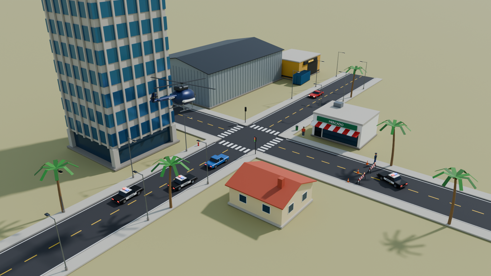
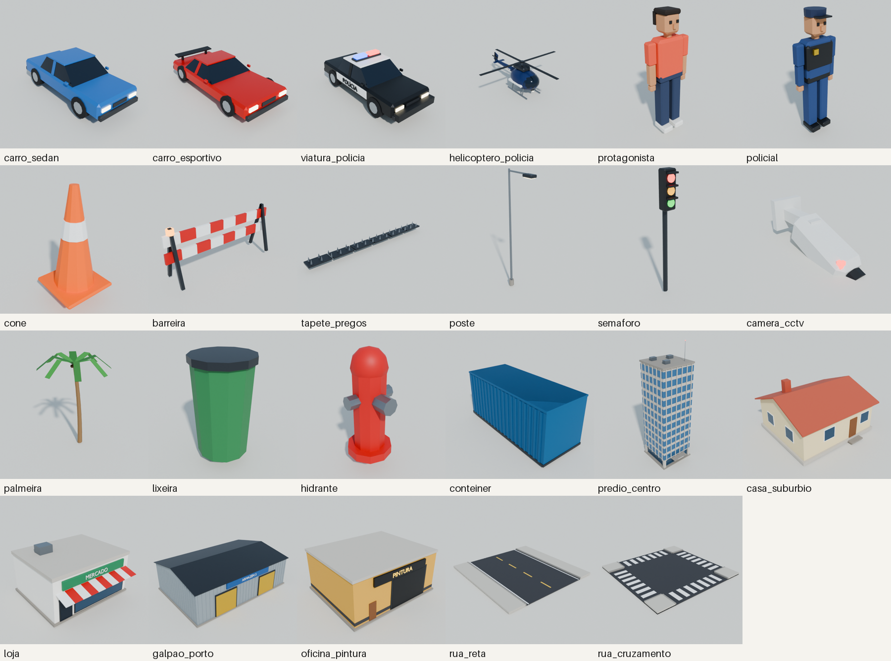

# Assets 3D – Porto Brasa

Modelos low-poly do jogo, gerados no **Blender 5.2** por script, com base na
[pesquisa](../../docs/pesquisa-jogo-mundo-aberto.md).





## Pastas

| Pasta | Conteúdo |
|---|---|
| `modelos/*.glb` | 23 modelos prontos para o jogo (glTF binário: Three.js, Godot, Unity, Unreal) |
| `blender/porto_brasa_assets.blend` | Arquivo do Blender: cena **Assets** (todos lado a lado, uma fileira por categoria) e cena **Cena_Demo** (cruzamento com perseguição) |
| `blender/gerar_assets.py` | Script que gera tudo (modelos, .blend, prévias, catálogo) |
| `blender/montar_catalogo.py` | Monta `previews/_catalogo.png` (precisa de Pillow) |
| `previews/` | Uma imagem por modelo + cena demo + catálogo |
| `catalogo.csv` | Medidas, triângulos e descrição de cada modelo |

## Lista de assets

| Categoria | Asset | Peças animáveis / trocáveis |
|---|---|---|
| Veículos | `carro_sedan`, `carro_esportivo` | `roda_diant_esq/dir`, `roda_tras_esq/dir` · material `Pintura_*` |
| | `viatura_policia` | rodas + `sirene_vermelha`, `sirene_azul` (piscar) |
| | `helicoptero_policia` | `rotor_principal`, `rotor_cauda` (girar), `holofote` |
| Personagens | `protagonista` | `cabeca`, `tronco`, `braco_esq/dir`, `perna_esq/dir` · `Roupa_Camisa`, `Roupa_Calca` |
| | `policial` | mesmos membros, com colete e quepe |
| Perseguição | `barreira` | `luz_alerta` |
| | `tapete_pregos`, `cone` | – |
| | `camera_cctv` | `led` (destruir = limpa a evidência "câmera") |
| Rua | `poste` | material `Luz_Poste` (ligar à noite) |
| | `semaforo` | `luz_vermelha`, `luz_amarela`, `luz_verde` |
| | `palmeira`, `lixeira`, `hidrante`, `conteiner` | `Pintura_Conteiner` |
| Prédios | `predio_centro` (Torre Brasa, ~49 m) | `luz_antena` |
| | `casa_suburbio` (casa segura) | `Pintura_Casa` |
| | `loja` (mercado, assalto pequeno) | – |
| | `galpao_porto` (Armazém 3) | – |
| | `oficina_pintura` (troca a cor do carro) | – |
| Ruas | `rua_reta`, `rua_cruzamento` | blocos de 12 × 12 m |

## Convenções

- **Escala:** 1 unidade = 1 metro. Origem de cada modelo no chão (z = 0), centralizada.
- **Frente:** +Y no Blender, que vira **−Z** no glTF / Three.js / Godot.
- **Ruas:** blocos de 12 × 12 m (asfalto de 8 m com 2 faixas de 4 m + calçadas de 2 m).
  A rua corre ao longo de Y; gire 90° para ruas no eixo X. Calçada a 0,17 m de altura.
- **Peças animáveis** são objetos separados, com o pivô na articulação (ombro,
  quadril, pescoço, centro da roda, eixo do rotor).
- **Materiais `Pintura_*` / `Roupa_*`:** clone o material por instância no jogo
  para trocar a cor (carro pintado, troca de roupa).
- **Luzes** usam emissão (`Sirene_*`, `Luz_*`, `Farol`, `Lanterna`): é só mudar a
  intensidade de emissão para ligar e desligar.
- Postes e semáforos: o braço/luz aponta para +Y. Na calçada da direita
  (x = +5,4) gire +90°; na da esquerda, −90°.

## Gerar de novo / editar

Com o Blender instalado:

```bash
cd game/assets/blender
blender -b -P gerar_assets.py -- --saida ..
```

Sem o Blender, como módulo Python (`pip install bpy`, Python 3.13):

```bash
python gerar_assets.py --saida ..            # ~2 min com prévias
python gerar_assets.py --saida .. --sem-render   # ~2 s, só modelos e .blend
python montar_catalogo.py .. ../previews/_catalogo.png
```

Para mudar um modelo, edite a função com o nome dele em `gerar_assets.py` (cada
asset é uma função com `@asset(...)`) e rode o script de novo. Também dá para
abrir o `.blend` e editar à mão, mas aí o script sobrescreve se for rodado
outra vez.
